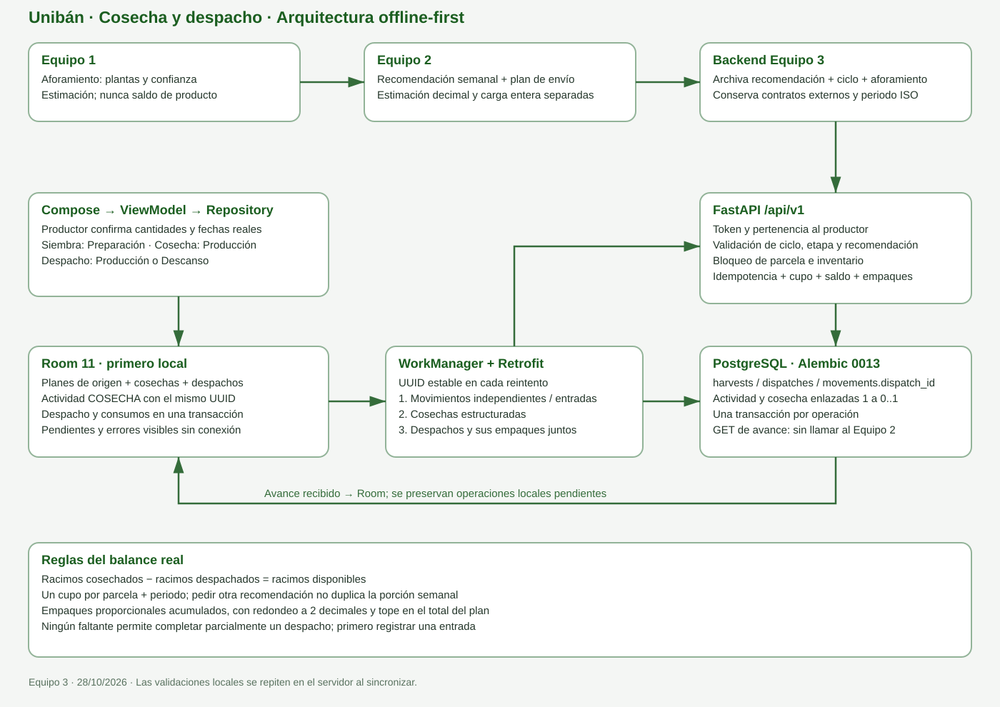

# Arquitectura de la aplicación

La app está diseñada offline-first: la información operativa se guarda primero en Room y se sincroniza con el backend cuando hay conexión. La base local es independiente por cuenta de Firebase. El backend central valida identidad y permisos, persiste los datos en PostgreSQL y actúa como puente entre los equipos.

El estado y los límites actuales están en [estado del proyecto](../gestion/estado-proyecto.md).

## Recorrido de datos

~~~text
Pantallas Compose → ViewModel → Repository → Room
                              ↘ Retrofit → FastAPI /api/v1 → PostgreSQL

WorkManager → movimientos independientes / entradas → cosechas → despachos con sus empaques
Firebase Authentication → identidad del productor
Equipo 1 → rutas de servicio FastAPI → aforamientos en PostgreSQL → app
App → rutas FastAPI de recomendación → servicio del Equipo 2 → respuesta guardada
~~~

La UI no accede directamente al DAO ni conoce detalles HTTP. El Equipo 1 se autentica con una clave de servicio; el Equipo 2 es llamado por el backend. La app solo habla con nuestro backend.

El [MER actualizado](../modelo-datos/MERv2.drawio) y el diagrama vectorial anterior representan las entidades y el flujo implementados. Un aforamiento estima plantas; una recomendación fija una porción semanal. Solamente los registros reales crean o reducen el saldo de racimos. No hay bodega de producto ni operaciones comerciales.

## Módulos Android

| Ubicación | Responsabilidad |
| --- | --- |
| ui/auth | Inicio de sesión, registro y completar el perfil del productor. |
| ui/inventory | Inventario, detalle, entradas, consumos, pérdidas, ajustes, historial y estado de sincronización. |
| ui/parcels | Lista, registro y detalle de parcelas; secciones de ciclo, actividades, aforamiento y recomendación. |
| ui/activities | Registro y lista de actividades productivas. |
| ui/production | Avance por periodo, cosecha real, despacho y faltantes de empaque. |
| ui/navigation | Navegación, protección de sesión y pestañas principales. |
| data/auth | Estado de sesión y perfil; integración con Firebase. |
| data | Repositorios de inventario, parcelas, sincronización e integración con recomendaciones. |
| data/local | Entidades, DAO y base Room, versión 11. Incluye archivo de planes, cosechas, despachos y consumos enlazados. Esquemas exportados en android-app/app/schemas. |
| data/remote | Interfaces Retrofit para usuarios, movimientos, actividades, parcelas y recomendaciones. |
| sync | Programación y ejecución de sincronización con WorkManager. |
| core/network | Cliente HTTP, URL base y tiempos de espera. |

Cada cuenta utiliza una base local con nombre asociado a su UID. Las tablas locales de parcelas, aforamientos y recomendaciones no dependen de una clave foránea hacia parcelas; esto permite reemplazar las copias sincronizadas sin borrar datos locales relacionados.

## Backend

La API organiza rutas en api/v1, contratos Pydantic en schemas, reglas de negocio en services, modelos SQLAlchemy en models y sesiones de base de datos en db. Alembic mantiene el esquema PostgreSQL; la revisión más reciente en este repositorio es 0013_cosechas_despachos.

### Rutas principales

- Usuarios: registro y perfil.
- Inventario y movimientos: consulta y recepción idempotente de movimientos.
- Actividades: recepción idempotente.
- Producción real: POST /harvests, POST /dispatches y GET /production/{parcelId}. Operaciones propias del Equipo 3, con recomendación, aforamiento y ciclo de origen.
- Parcelas: registro y consulta del productor, con ciclo y aforamiento reciente.
- Aforamientos: escritura autenticada por clave de servicio desde el Equipo 1.
- Servicio de parcelas: consulta global mínima autenticada por clave de servicio para el Equipo 1.
- Recomendaciones: el productor solicita y consulta la última recomendación de su parcela; el backend llama al Equipo 2.

## Reglas que protegen los datos

- Un productor solo accede a sus datos; las rutas de negocio exigen token válido y perfil.
- Movimientos y actividades se identifican por UUID para tolerar reintentos sin duplicar registros.
- El movimiento y el cambio de existencia se guardan de forma consistente; no se permite saldo negativo.
- Las actividades se sincronizan antes que sus consumos relacionados.
- Una cosecha y su actividad comparten UUID y transacción; se excluyen del envío genérico. Los despachos y sus consumos viajan juntos, una vez confirmadas las cosechas del periodo. Un fallo conserva el registro y el error.
- Se archiva el plan de origen para que actualizar el aforamiento o la recomendación no reinicie el avance. La clave de cupo es parcela + periodo ISO recibido del Equipo 2. La solicitud conserva la semana del aforamiento; no se sustituye por la semana del día de la petición.
- En PostgreSQL se bloquea la parcela durante validaciones y escrituras para evitar duplicar cupo o saldo entre teléfonos; los inventarios se bloquean al aplicar consumos y movimientos. El GET del avance también toma un corte coherente. La verificación SQLite no demuestra estos bloqueos concurrentes de PostgreSQL.
- Las claves de servicio y las conexiones de base de datos se configuran como secretos fuera del repositorio.
- El backend conserva los registros centrales; Room permite seguir trabajando offline, pero la app no descarga el inventario completo para restaurar un teléfono nuevo.

Para las variables y los pasos de ejecución, ver [README del backend](../../backend/README.md). Para producción, ver [despliegue](../operacion/despliegue-render.md).
