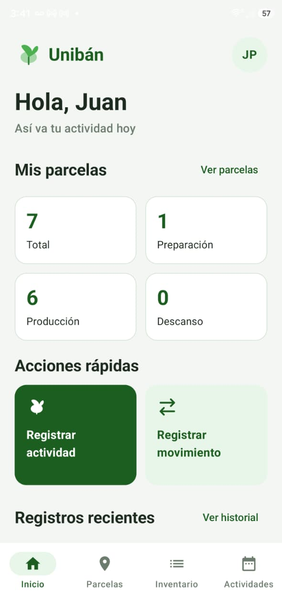
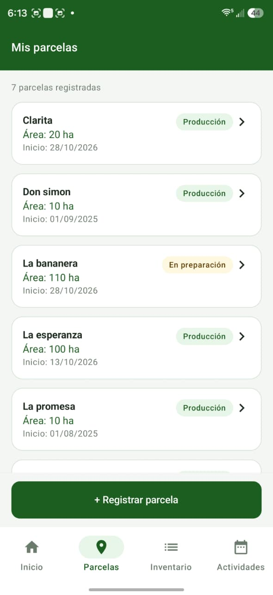
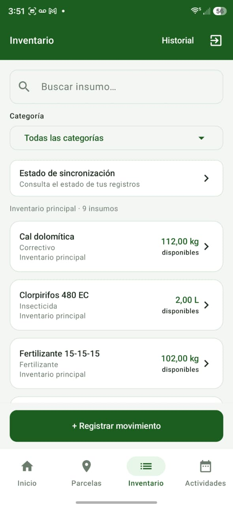
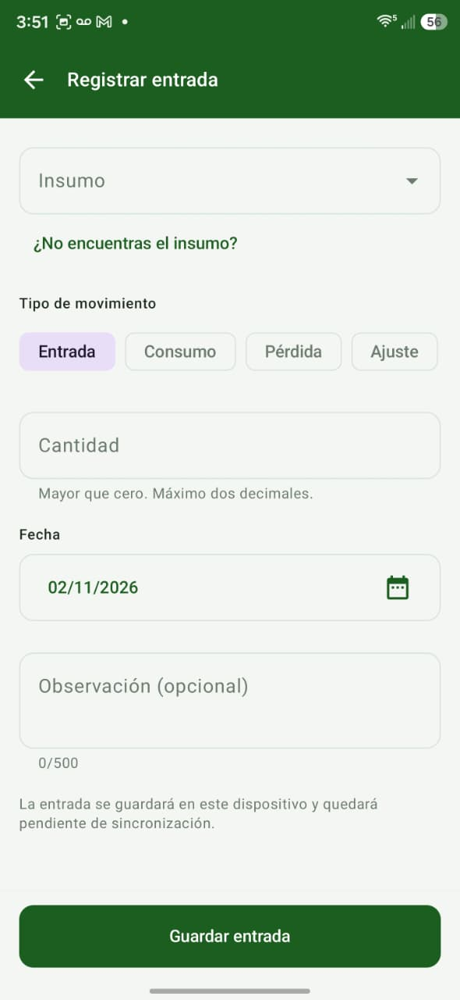
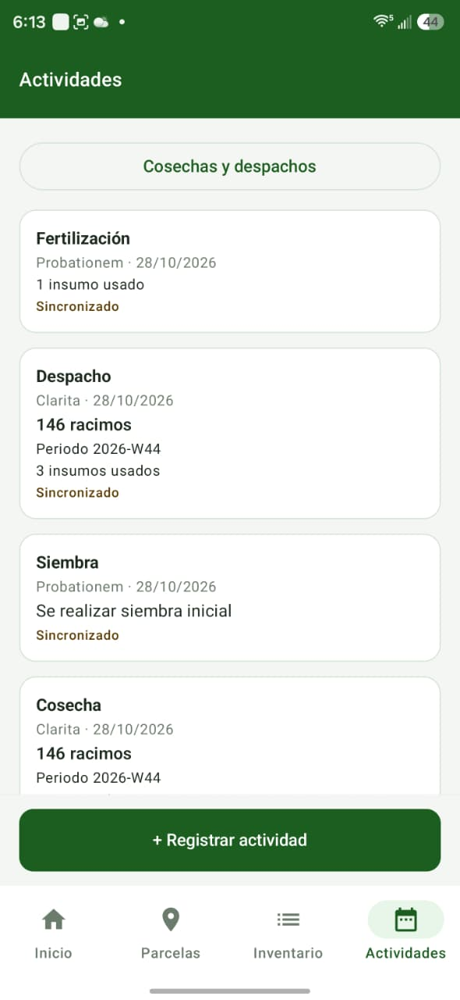
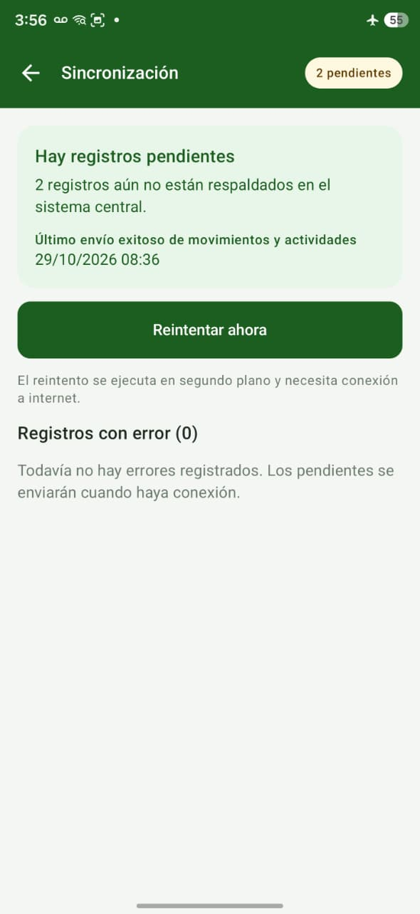
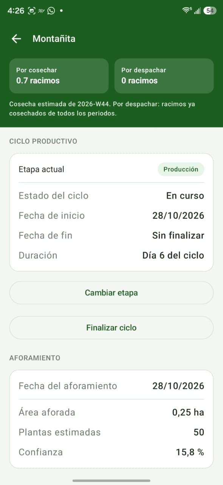
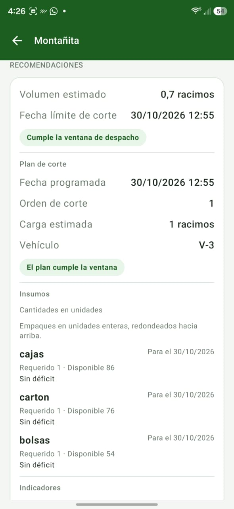

# Informe de validación, pruebas y limitaciones

**Proyecto:** Sistema UNIBÁN — Equipo 3, gestión de suministros
**Componente:** aplicación Android y servicios de gestión e integración

## 1. Objetivo

Presentar los resultados de las pruebas automatizadas y de la validación manual de la aplicación, incluyendo la gestión de parcelas, insumos y actividades, la operación sin conexión y la información intercambiada con los equipos de aforamiento y planificación logística.

## 2. Resultados de pruebas automatizadas

Las dos suites se ejecutaron completas el **14 de noviembre de 2026** sobre la revisión `1e0be63` de `main` (la que se entrega), en un equipo con Windows 11. El backend usa bases de prueba locales (SQLite en memoria) y Android corre sus pruebas unitarias con Robolectric, sin emulador:

| Componente | Resultado                 | Duración       | Observaciones                                                                                                          |
| ---------- | ------------------------- | -------------- | ---------------------------------------------------------------------------------------------------------------------- |
| Backend    | **301 aprobadas, 0 fallidas** | 11,7 segundos | Una advertencia de deprecación de una dependencia de pruebas. |
| Android    | **340 aprobadas, 0 fallidas, 0 omitidas** | 130 segundos | Conteo tomado de los reportes JUnit de Gradle (`app/build/test-results/testDebugUnitTest`). |

El comando utilizado para el backend fue `python -m pytest -q`; para Android se ejecutó `gradlew.bat testDebugUnitTest --rerun-tasks` con Java 17 (`--rerun-tasks` obliga a correr todas las pruebas, sin resultados en caché). Una ejecución anterior, del 2 de noviembre sobre `e588e52`, dio los mismos conteos. La duración indicada mide la ejecución del conjunto de pruebas del backend, no el tiempo de respuesta del servicio en producción.

Las pruebas abarcan, entre otros aspectos, autenticación, inventario y movimientos, parcelas y ciclos, actividades, sincronización, aforamientos, recomendaciones, cosechas y despachos. Su código está disponible en `backend/tests` y `android-app/app/src/test`.

## 3. Validación manual de la aplicación

Las siguientes capturas corresponden a la aplicación utilizada durante las pruebas del equipo. Los valores corresponden a los datos de los escenarios mostrados.

### 3.1. Inicio y parcelas

La pantalla principal resume **7 parcelas**: 1 en preparación, 6 en producción y ninguna en descanso. El listado presenta el área y la etapa de cada parcela y ofrece el registro de nuevas parcelas.

*Figura 1. Inicio y resumen de parcelas.*

*Figura 2. Consulta de parcelas y etapas productivas.*

### 3.2. Inventario y movimientos

El inventario muestra los insumos con su categoría, unidad y cantidad disponible; también incluye búsqueda y selección por categoría. El formulario ofrece los movimientos de entrada, consumo, pérdida y ajuste.

*Figura 3. Inventario de insumos.*

*Figura 4. Registro de movimientos de inventario.*

### 3.3. Actividades, cosecha y despacho

En el historial aparecen actividades de fertilización y siembra, además de una cosecha y un despacho de **146 racimos** para la parcela Clarita, asociados al periodo 2026-W44. El despacho aparece sincronizado y registra el uso de tres insumos.

*Figura 5. Actividades productivas y registros de cosecha y despacho.*

### 3.4. Operación sin conexión y sincronización

En la secuencia se observa inicialmente la pantalla sin registros pendientes; posteriormente, con el indicador de modo avión, la app muestra **2 registros pendientes** y **0 errores**. En la pantalla posterior aparecen **0 pendientes**, **0 errores** y un último envío exitoso del 02/11/2026 a las 16:00.

*Figura 6. Estado inicial de sincronización.*

*Figura 7. Dos registros pendientes durante la operación en modo avión.*

*Figura 8. Estado posterior, con último envío exitoso y sin pendientes.*

## 4. Validación de la integración entre equipos

El flujo integrado conecta el aforamiento del Equipo 1 con la información operativa gestionada por el Equipo 3 y la recomendación del Equipo 2. La aplicación presenta los resultados asociados a la parcela para apoyar la planificación de la cosecha y el despacho.

### 4.1. Información de aforamiento — Equipo 1

La parcela Montañita presenta un aforamiento con fecha **28/10/2026**, área de **0,25 ha**, **50 plantas estimadas** y confianza de **15,8 %**. La pantalla muestra también el ciclo en producción y el periodo de cosecha.

*Figura 9. Aforamiento presentado en el detalle de la parcela.*

### 4.2. Recomendación de planificación — Equipo 2

Para la misma parcela, la app presenta una recomendación de **0,7 racimos estimados**, carga planificada de **1 racimo**, vehículo **V-3** y fecha límite de corte del **30/10/2026 a las 12:55**. También presenta los requerimientos y existencias de cajas, cartón y bolsas, así como el cumplimiento de la ventana de despacho.

*Figura 10. Recomendación de corte, despacho e insumos.*

### 4.3. Contratos de intercambio

- **Contrato de integración con el Equipo 1:** https://github.com/JuanSebastian05/uniban-app-suministros/blob/main/docs/contrato-equipo1.md
- **Contrato de integración con el Equipo 2:** https://github.com/JuanSebastian05/uniban-app-suministros/blob/main/docs/contrato-equipo2.md

### 4.4. Escenarios simulados y pruebas conjuntas

No hubo acceso a registros reales de cosecha de Unibán, así que la integración se comprobó con **escenarios simulados declarados como tales** y con pruebas conjuntas contra los servicios desplegados. El detalle está en el informe IEEE conjunto de los tres equipos (secciones E3, E4 y E5):

| Prueba | Datos | Resultado |
| --- | --- | --- |
| Caso de referencia calculado a mano y repetido por el servicio | 1 850 plantas, confianza 0,87; inventario de 80 cajas, 120 de cartón y 200 bolsas; ventana de 06:00 a 16:00 | El servicio reprodujo exactamente el cálculo manual: 145,6 racimos, corte a las 12:55, 123,76 cajas requeridas (déficit de 43,76) y excedente de 54,4 bolsas. |
| Flujo integrado en la app del productor | Parcela Clarita | Aforamiento de 94 plantas y recomendación de 4,9 racimos, con el plan de corte y los insumos requeridos. |
| Operación sin conexión | 7 movimientos de inventario registrados en modo avión (emulador) | Al recuperar la red, el servidor respondió `201 Created` a las 7 solicitudes; la app terminó con 0 pendientes y 0 errores. |
| Propagación del error | Conteo perturbado en ±5, ±10 y ±20 %; confianza entre 0,60 y 0,95 | Un error de 10 % en el conteo cambia el déficit de cajas en 28 %, y la confianza pesa todavía más. |

**Defectos que encontraron las pruebas conjuntas** (y que las pruebas de cada componente no detectaban):

1. Un aforamiento sin confianza, permitido por el contrato entre los Equipos 1 y 3, producía un error interno en vez de una respuesta de dato faltante. **Corregido.**
2. Las tablas de la base de producción no existían porque las migraciones no corrían en el despliegue. **Corregido**: las migraciones se aplican antes de desplegar (ver [lista de verificación](../operacion/lista-verificacion-despliegue.md)).
3. Una ventana de despacho derivada de la fecha del aforamiento podía quedar en el pasado y aun así reportarse como cumplida. **Corregido**: la ventana se calcula desde la fecha de consulta.

## 5. Indicadores observados

| Indicador                                               | Resultado                         | Contexto                                                             |
| ------------------------------------------------------- | --------------------------------- | -------------------------------------------------------------------- |
| Parcelas en la cuenta                                   | 7                                 | 1 en preparación y 6 en producción, según la pantalla de inicio.     |
| Registros pendientes durante la prueba                  | 2                                 | Estado mostrado con modo avión activado.                             |
| Registros pendientes y con error en el estado posterior | 0 pendientes; 0 errores           | Pantalla que informa último envío exitoso a las 16:00.               |
| Aforamiento mostrado                                    | 50 plantas en 0,25 ha             | Parcela Montañita; confianza de 15,8 %.                              |
| Recomendación mostrada                                  | 0,7 racimos estimados; carga de 1 | Parcela Montañita; vehículo V-3.                                     |
| Cosecha y despacho registrados                          | 146 racimos en cada registro      | Parcela Clarita, periodo 2026-W44; despacho con tres insumos usados. |

Los indicadores corresponden a los escenarios de las capturas y permiten observar el comportamiento del producto con los datos utilizados durante la demostración.

## 6. Limitaciones técnicas

- La consulta de información previamente guardada y el registro de operaciones pueden funcionar sin conexión; crear parcelas, modificar etapas o ciclos, recibir un nuevo aforamiento y solicitar una nueva recomendación requieren conexión.
- Los cambios registrados sin conexión se sincronizan posteriormente y pueden requerir revisión si el estado del servidor cambió durante la desconexión. La app no reconstruye automáticamente todo el inventario al reinstalarse o cambiar de dispositivo.
- Una solicitud al Equipo 2 sin confianza numérica puede ser rechazada (Aunque es poco probable ya que eso es responsabilidad del equipo 1)
- El formulario de inventario contempla entradas, consumos, pérdidas y ajustes; el tipo genérico SALIDA no está habilitado desde la app.
